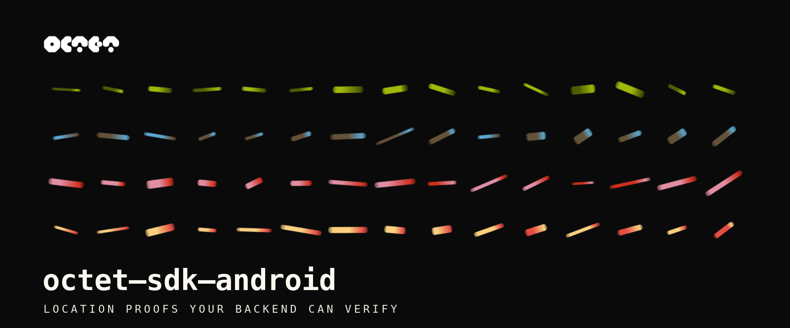

<p align="center">
  <a href="https://octetproof.com">
    
  </a>
</p>

<div align="center">

**Ask where an Android device is, and get a signed proof your backend can verify.**

[](https://github.com/octetproof/octet-sdk-android/releases) [](#install) [](https://octetproof.com/docs/mobile/) [](LICENSE) [](https://github.com/octetproof/octet-sdk-android)

[](https://octetproof.com) [](https://octetproof.com/docs/mobile/) [](https://verifier.octetproof.com/)

</div>

> [!IMPORTANT]
> **Octet proves; you decide.** OctetSDK proves where the device is and returns the
> answer with a signed proof. It does not block, allow or change anything in your app or
> on your servers. Your backend verifies the proof and decides what happens to the
> request. If your backend ignores the answer, nothing is enforced.

## What it is

Many apps have to know where a user is before they allow something: a payment from a
sanctioned country, a game in a jurisdiction where it isn't licensed, content outside
its rights region. A GPS reading or an IP address is easy to fake, and a yes/no that
your app reports is only as trustworthy as the device it runs on.

OctetSDK answers a location question, such as *"Is the device in the US?"*, with
**YES**, **NO** or **INDETERMINATE**, backed by evidence instead of a claim:

- **A signed location proof.** Every YES or NO carries a proof signed by a device key
  that the SDK creates in StrongBox or the Trusted Execution Environment where it can.
  Each proof reports the key's storage tier, so your verifier decides what to accept.
- **An attested install.** The SDK activates with Android hardware key attestation, so
  the proof comes from a genuine device. There is no licence key to ship.
- **Spoofing checks on the device.** A suspected spoofed or mocked location, or a
  tampered device, returns INDETERMINATE with a reason code and no proof.
- **Fail-closed.** When the SDK can't answer, for example before the first location
  fix, the answer is INDETERMINATE with a reason code and no proof, never a guess.
- **A region, not a trace.** A country question gets a proof that names the country.
  Your backend receives that proof, not the device's GPS history.
- **One call.** `sdk.loc.isWithin(region)` asks the question and returns the answer
  with its proof.

## Install

Add Octet's Maven repository in `settings.gradle.kts`, then the dependency in your app
module:

```kotlin
// settings.gradle.kts → dependencyResolutionManagement { repositories { … } }
maven { url = uri("https://raw.githubusercontent.com/octetproof/octet-sdk-android/mvn-repo") }

// app/build.gradle.kts
implementation("com.octetproof:sdk:3.1.2")
```

Requires `minSdk 30`, `compileSdk 34`, Kotlin 2.1 and AndroidX. The SDK ships for
`arm64-v8a` only, so the standard x86_64 emulator can't run it: develop on a physical
device. An emulator or CI build activates with a sandbox token instead (see
[Activation](INTEGRATION.md#activation)).

## Quick start

The SDK's manifest merges the permissions it needs into your app. Before the first
call, request `ACCESS_FINE_LOCATION` (the SDK doesn't start without it) and
`ACTIVITY_RECOGNITION` at runtime, and register your app with Octet at
[octetproof.com](https://octetproof.com). The permission list is in
[`INTEGRATION.md`](INTEGRATION.md#runtime-permissions).

```kotlin
import com.octetproof.sdk.api.Octet
import com.octetproof.sdk.api.OctetConfig
import com.octetproof.sdk.api.OctetRegion

// 1. Start the SDK. It activates with hardware key attestation, so there's no licence key.
val sdk = Octet.start(applicationContext, OctetConfig())

// 2. Ask one question. The answer is YES, NO or INDETERMINATE.
val verdict = sdk.loc.isWithin(OctetRegion.country("US"))

// 3. Send the proof to your backend. It verifies the proof and decides.
verdict.proof?.let { myBackend.submit(proof = it.proofBytes) }
```

`Octet.start` and `isWithin` are suspend functions, so call them from a coroutine, for
example in `lifecycleScope.launch`. `isWithin` returns an `OctetVerdict` (`result`,
`reason`, `proof`, `validity`, `achievableLevel`). It never throws: an answer it can't
give comes back as `INDETERMINATE` with a `reason`. `Octet.start` throws a typed
`LicenseError` when activation fails. `myBackend` stands for your own API.

> [!TIP]
> A full demo app is in [`sample/`](sample/). [`INTEGRATION.md`](INTEGRATION.md) has
> the prerequisites, every option, the reason codes and the verifier setup.

## How it works

```text
  1. your app                    2. your backend                   3. you
 ┌─────────────────────┐ proof  ┌─────────────────────────┐       ┌────────────────┐
 │ OctetSDK proves     │ ─────► │ verifies the proof,     │ ────► │ decide: allow, │
 │ where the device is │        │ offline, with           │       │ step up, block │
 │ and signs a proof   │        │ octet-verify            │       │ …              │
 └─────────────────────┘        └─────────────────────────┘       └────────────────┘
```

The SDK combines on-device evidence with hardware key attestation, signs each stage of
the proof with its hardware-backed key, and returns the proof with the answer. The
proof carries its key attestation certificate chain, so your backend can verify it
with the open-source [`octet-verify`](https://github.com/octetproof/octet-verify)
without calling Octet.

## Reading the answer

| Answer | When | In the verdict | What your backend might do |
|---|---|---|---|
| **YES** | The device is inside the region you asked about. | `result == YES`, a proof is attached | Your rule for YES: allow, or block, depending on the question |
| **NO** | The device is outside that region. | `result == NO`, a proof is attached | Your rule for NO |
| **INDETERMINATE** | The SDK can't answer right now, or it detected spoofing or tampering. | `result == INDETERMINATE`, no proof, `reason` says why, for example `NO_FIX` or `SPOOFING_DETECTED` | Ask again, step up, or refuse. Don't read it as NO. |

When the reason is `INSUFFICIENT_PRECISION`, `achievableLevel` names the best level the
SDK can prove right now. The SDK never answers at a coarser level than you asked for.
Every reason code and how to handle it is in
[`INTEGRATION.md`](INTEGRATION.md#interpreting-a-verdict--reason-codes--achievable-level)
and the [verdicts guide](https://octetproof.com/docs/mobile/concepts/verdicts/).

> [!WARNING]
> **Verify the proof on your server, not the result in the app.** The app's copy of
> `result` is only as trustworthy as the device. Your backend checks the proof with
> `octet-verify` and reads the answer from the signed proof. To also require genuine
> hardware, build `octet-verify` with its `appattest` feature and pass
> `--require-attestation`. See
> [Verifying proofs](https://octetproof.com/docs/mobile/concepts/verifying-proofs/) and
> [`INTEGRATION.md`](INTEGRATION.md#keeping-your-verifier-current) for the verifier
> version this release needs.

## Verifying the download

The Maven repository on the `mvn-repo` branch serves a `.sha256` checksum next to each
artifact. Each release also attaches the AARs (`sdk` and its native `libpf`),
`SHASUMS256.txt`, its keyless [Sigstore](https://www.sigstore.dev/) signature
(`SHASUMS256.txt.sig` and `SHASUMS256.txt.pem`), a CycloneDX SBOM and a prebuilt sample
APK. The signing certificate names Octet's release workflow, so a signature from any
other workflow fails the check.

To check the release files yourself, run the `shasum` and `cosign` commands in
[`INTEGRATION.md`](INTEGRATION.md#verifying-your-octetsdk-download).

## Sample app

A Jetpack Compose demo is in [`sample/`](sample/). It generates proofs, verifies them
on the device with `Octet.verify`, and exports them as files. See
[`sample/README.md`](sample/README.md) to build it from the command line or in Android
Studio.

## Documentation

- [Mobile SDK docs](https://octetproof.com/docs/mobile/): concepts, the
  [Android quick start](https://octetproof.com/docs/mobile/getting-started/android-quickstart/)
  and the API reference.
- [`INTEGRATION.md`](INTEGRATION.md): permissions, configuration, reason codes and
  verification.
- [`CHANGELOG.md`](CHANGELOG.md): changes that affect your integration.
- [octet-sdk-ios](https://github.com/octetproof/octet-sdk-ios): the iOS Swift Package.
- [octet-sdk-react-native](https://github.com/octetproof/octet-sdk-react-native): the
  React Native package.
- [octet-verify](https://github.com/octetproof/octet-verify): the open-source verifier
  for your backend.

## About this repository

This repository holds the Maven repository (on the `mvn-repo` branch), the release
files (under Releases), a sample app and the documentation. Each release is one
commit, tagged with its version. Bug reports and questions are welcome as issues.

## Security

Report a vulnerability privately to security@octetproof.com, not in an issue. See
[SECURITY.md](SECURITY.md).

## License

See [LICENSE](LICENSE).
